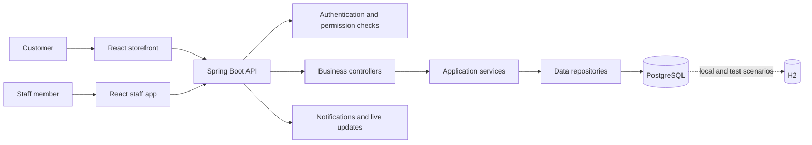

# Merce Italiana — Private-Code Case Study

> **Private project, public case study.** The application's source repository is private. This page explains the product, architecture, workflows, and selected file/class names at a non-sensitive level. It contains no application source code, credentials, internal configuration, or real customer or business data.

## Project summary

Merce Italiana is a clothing-retail platform with two connected experiences: a customer storefront and a staff application. Both use a shared backend for product, inventory, customer, and order workflows.

**My role:** Full-stack developer  
**Application:** React storefront and staff app → Spring Boot API → PostgreSQL  
**Status:** Active development; production configuration and full test verification are still in progress.

## Why I built it

A clothing business needs a customer shopping experience and a way for staff to manage the work behind it. Merce Italiana separates those interfaces while connecting catalog, inventory, customer, and order workflows through a shared backend.

## Who uses it

- **Customers** browse the catalog, manage a cart, and submit orders through the storefront.
- **Staff** work with products, stock, customers, orders, and operational views through the staff app.
- **Managers** access additional administrative and reporting features when their role allows it.

The backend checks permissions for protected staff actions. This case study does not publish the private permission matrix or business-specific policies.

## How an order moves through the app

1. A customer browses products in the storefront and builds a cart.
2. The storefront sends the order request to the shared backend.
3. The backend validates the request and checks current stock during checkout.
4. The order workflow records the order and related inventory movement.
5. Staff review and process the order from the staff application.
6. Cash payment status is updated through a permission-controlled workflow.
7. The backend returns the updated order state to the relevant application.
8. Staff can use operational views, reports, receipts, and notifications to follow store activity.

## How the parts connect

The storefront and staff app have different audiences but share backend capabilities. Controllers receive requests, services apply business rules, repositories handle persistence, and DTOs define the data returned to the frontends.

## Selected files and classes

The map below shows representative names documented in the private project and their broad responsibilities. It does not reproduce the source tree or implementation.

### Main folders and files

| Name | Purpose |
|---|---|
| `merce-italiana-backend/` | Spring Boot API and backend workflows |
| `merce-italiana-frontend/` | Staff-facing React application |
| `merce-italiana-storefront/` | Customer-facing React application |
| `MerceItalianaApplication.java` | Starts the Spring Boot application. |
| `src/main.jsx` | Boots a React frontend. |
| `src/App.jsx` | Composes frontend routes and views. |
| `src/index.css` | Shared frontend styles. |
| `vite.config.js` | Frontend build and development configuration. |

### Backend controllers

| Class | Role |
|---|---|
| `AuthController` | Sign-in and account-access workflows. |
| `ProductController` | Product catalog and inventory requests. |
| `CustomerController` | Customer records and lookup. |
| `OrderController` | Order creation and staff order operations. |
| `CartController` | Cart updates and checkout requests. |
| `PaymentController` | Cash payment status workflow. |
| `DashboardController` | Permission-aware dashboard data. |
| `ReportController` | Operational and performance reports. |
| `NotificationController` | Staff notification history and read state. |
| `AuditController` | Read and export access to audit records. |
| `CouponController` | Coupon validation and management. |
| `SettingsController` | Store settings and backup operations. |

### Backend services

| Class | Role |
|---|---|
| `AuthService` | Account access and authentication workflows. |
| `ProductService` | Product and catalog behavior. |
| `StockMovementService` | Inventory movement history. |
| `OrderService` | Order lifecycle and related stock changes. |
| `CartService` | Cart lifecycle and checkout coordination. |
| `PaymentService` | Cash payment status handling. |
| `CustomerService` | Customer lookup and management. |
| `DashboardService` | Dashboard data filtered by permissions. |
| `ReportService` | Summary and operational report data. |
| `NotificationService` | Persisted and live staff notifications. |
| `AuditService` | Audit event recording and queries. |
| `CouponService` | Coupon rules and redemption behavior. |
| `ReceiptService` | Receipt generation. |
| `BackupService` | Backup workflow and history. |

### Data and persistence classes

| Class | Role |
|---|---|
| `User` | Staff account and identity. |
| `Role` | Named access role. |
| `Permission` | Named capability used for access decisions. |
| `Product` | Catalog item and stock-related data. |
| `Category` | Product grouping. |
| `StockMovement` | A recorded stock change. |
| `Customer` | Customer record. |
| `Order` | Customer order and lifecycle state. |
| `Cart` | Customer cart and its lifecycle. |
| `CartItem` | Product and quantity in a cart. |
| `Coupon` | Discount rule and current status. |
| `AuditLog` | Recorded operational action. |
| `Settings` | Store-level settings. |
| `BackupRecord` | Backup history entry. |

### Supporting file groups

| Name | Role |
|---|---|
| `SecurityConfig` | Configures protected backend access. |
| `JwtService` | Supports token-based authentication. |
| `GlobalExceptionHandler` | Returns consistent error responses. |
| `WebSocketConfig` | Sets up live notification transport. |
| `UserRepository`, `RoleRepository`, `PermissionRepository` | Persist account and access data. |
| `ProductRepository`, `CategoryRepository`, `StockMovementRepository` | Persist catalog and stock data. |
| `CustomerRepository`, `OrderRepository` | Persist customer and order data. |
| `CartRepository`, `CartItemRepository` | Persist carts and their items. |
| `CouponRepository`, `AuditLogRepository` | Persist coupon and audit records. |
| `dto/` | Groups request and response models used at the API boundary. |
| `db/migration/` | Versioned database schema changes managed by Flyway. |

## Engineering notes

- **Languages:** Java, JavaScript, SQL, HTML, CSS.
- **Frontend:** React, Vite, Tailwind CSS, Axios, TanStack Query.
- **Backend:** Spring Boot, Spring Security, Spring Data JPA, REST, WebSocket.
- **Data:** PostgreSQL; H2 for local and test scenarios.
- **Schema changes:** Flyway.
- **Tools:** Maven Wrapper, npm, Git, automated tests.
- **Authentication:** JWT and backend roles/permissions.

## Current status

This project is in active development. Production deployment configuration and full test verification remain in progress, and some test failures need to be resolved before a production release.

## Screenshots

Screenshots will be added later using synthetic or anonymized data. They will be checked to avoid exposing private customer, order, or business information.

## Privacy

The original source repository is private. This case study shares selected names and high-level responsibilities only. It does not include code, credentials, private endpoints, deployment configuration, real customer records, or internal business data.
